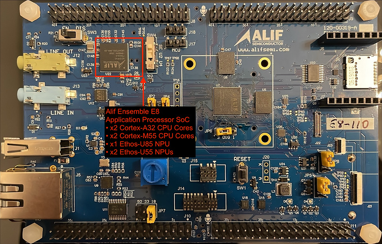
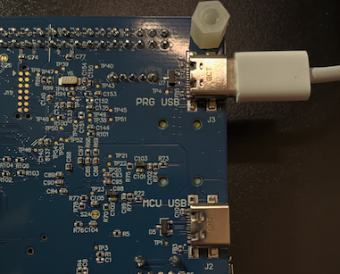

## Arm AI Portal

The [Arm AI Portal](https://developer.arm.com/ai) is a catalog of AI models across different runtimes, use cases, and profiles that are optimized for different Arm-based targets. The AI Portal provides benchmarking and compatibility data, code examples, and deployment methods.

You'll build an Alif E8 application that uses the [QuickSRNetSmall](https://developer.arm.com/ai/models/hugging-face/Arm/qai-quicksrnetsmall-int8-ethos-u-executorch-alif-dk-e8/quicksrnetsmall-int8-pte) or [SESR-M5](https://developer.arm.com/ai/models/hugging-face/Arm/sesr-m5-int8-ethos-u-executorch-alif-dk-e8/sesr-m5-int8-pte) models from the Arm AI Portal to upscale images on the Ethos-U85 NPU. You'll send an image from your computer, retrieve the upscaled result, and optionally preview it on an attached display.


## Understand the Alif Ensemble E8 hardware

The Alif Ensemble E8 DevKit features two dual-core Arm processors (Cortex-A32 and Cortex-M55) and three neural processing units (NPUs): two Ethos-U55s and one Ethos-U85. In this application, the **Cortex-M55 CPU** runs Executorch and coordinates inference on the **Ethos-U85 NPU**.  



{}
This learning path was tested on an [Alif Ensemble E8 DevKit](https://alifsemi.com/support/kits/ensemble-e8devkit/) with a supported display attached. If you are using the [E8 AI/ML AppKit](https://alifsemi.com/support/kits/ensemble-e8appkit/) instead, be sure to set the appropriate target board in your build commands: `-DTARGET_BOARD=AppKit-e8`. 
{}

## Connect to the Alif Ensemble E8 DevKit

To connect to the Alif Ensemble E8 DevKit:

1. Unplug all USB cables from the DevKit before changing any jumpers.

2. Verify that the jumpers are in their factory default positions, as shown in the Alif Ensemble E8 DevKit (DK-E8) User Guide on [alifsemi.com](https://alifsemi.com/support/kits/ensemble-e8devkit/).

3. Connect a USB-C cable from your computer to the PRG USB port on the bottom edge of the DevKit.



4. Confirm that a green LED illuminates near the E1 device and the UART switch (SW4).

Leave SW4 in its default position (SE). This routes the on-board USB UART to SEUART, which the Alif Security Toolkit (SETOOLS) uses for programming.

## Check the host development tools

Before you run the commands, ensure your development machine has the prerequisite tools installed.

Open a terminal on Linux or an Apple silicon Mac. On Windows, use [WSL 2 with Ubuntu 22.04](https://learn.microsoft.com/en-us/windows/wsl/install) and run these commands in your Ubuntu terminal. The Windows flashing steps use PowerShell, so lookout for commands that specify Windows (Powershell).

Run the check for tools:

```bash
git --version
python3 --version
python3 -m pip --version
make --version
arm-none-eabi-gcc --version
curl --version
unzip -v
```

Install any missing host tools before continuing. Ensure that you use **Python 3.10-3.12** and [Arm GNU Toolchain 13.2.Rel1](/install-guides/gcc/arm-gnu/) (GCC 13.2.1).

## Create the project directory

Create a working directory for the application. On Windows, run these commands in WSL Ubuntu so the repository is stored in the Linux filesystem:

```bash
mkdir -p "$HOME/alif-image-upscaling"
cd "$HOME/alif-image-upscaling"
```

## Clone the Alif MLEK repository

The [Alif ML Embedded Evaluation Kit (MLEK)](https://github.com/alifsemi/alif_ml-embedded-evaluation-kit) provides the board support, ExecuTorch integration, and build system for the application. Clone it into a directory named `mlek`:

```bash
git clone https://github.com/alifsemi/alif_ml-embedded-evaluation-kit.git mlek
cd mlek
git checkout 3778ff7a21133be210cf762b543fc9eb318c197e
git submodule update --init --recursive
```

The explicit checkout pins the project to the revision used for this application.

## Set up the MLEK resources

Run the setup script with ExecuTorch enabled:

```bash
python3 set_up_default_resources.py \
  --ml-frameworks executorch \
  --use-case img_class \
  --skip-vela
```

The first run creates a Python environment and downloads the pinned model and framework dependencies. The run can take several minutes.

The `img_class` resource group supplies the base image-example resources. `--skip-vela` skips model optimization because you'll download the compiled upscaling models from the Arm AI Portal on the next page.

Activate the generated Python environment and verify CMake:

```bash
source resources_downloaded/env/bin/activate
cmake --version
```

CMake should report version **3.30.5**. Keep this terminal open for the remaining model preparation and build commands.

## Install SETOOLS

Secure Enclave Tools (SETOOLS) is Alif's toolset for flashing firmware to MRAM through the Secure Enclave.

Download the SETOOLS package for your host operating system from the [Alif Ensemble E8 DevKit support page](https://alifsemi.com/support/kits/ensemble-e8devkit/). Name the extracted directory `setools` and place it under `alif-image-upscaling` in your home directory. The `setools` directory should directly contain the tools and their supporting files.

On Windows, use the Windows package and open a separate PowerShell terminal for the SETOOLS steps. Place `setools` under `$HOME\alif-image-upscaling` in your Windows home directory.

Verify the installation:

**macOS and Linux**

```bash
cd "$HOME/alif-image-upscaling/setools"
./app-write-mram -h
./app-gen-toc -h
```

**Windows PowerShell**

```powershell
cd "$HOME\alif-image-upscaling\setools"
.\app-write-mram.exe -h
.\app-gen-toc.exe -h
```

Each command should print a `usage:` message. If either command fails, check that you're in the extracted SETOOLS directory for your operating system.

{}
On macOS, the system might block the unsigned binary the first time you run it. If this happens, do the following:

1. Open **System Settings** or **System Preferences**.
2. Navigate to **Privacy & Security**.
3. Select **Allow Anyway**.

Then, run the command again. You might need to reapprove for both `./app-*` commands.
{}

## Update the board support firmware

Open a terminal in the extracted SETOOLS directory. Run the tools from the SETOOLS directory because they load configuration and supporting files using relative paths:

**macOS and Linux**

```bash
./updateSystemPackage -d
```

**Windows PowerShell**

```powershell
.\updateSystemPackage.exe -d
```

Select the DevKit serial port when prompted. The output is similar to:

```output
[INFO] /dev/ttyACM0 open Serial port success
Bootloader stage: SERAM
[INFO] Detected Device:
Part# AE822FA0E5597LS0 - Rev: A0
Connected target is not the default Revision
Do you want to set this part as default? (y/n): y
Maintenance Mode = Enabled
...
Verify Image
Done
```

The serial port, package names, progress details, and elapsed time can differ. The default revision message is expected during initial setup. Answer `y` to make the detected E8 revision the default.

Before continuing, return to your macOS, Linux, or WSL Ubuntu build terminal and the MLEK repository:

```bash
cd "$HOME/alif-image-upscaling/mlek"
```

## What you've accomplished and what's next

You've connected the DevKit, prepared the MLEK Python environment, and installed SETOOLS. Next, you'll add the image upscaling application and download the Arm AI Portal models.
